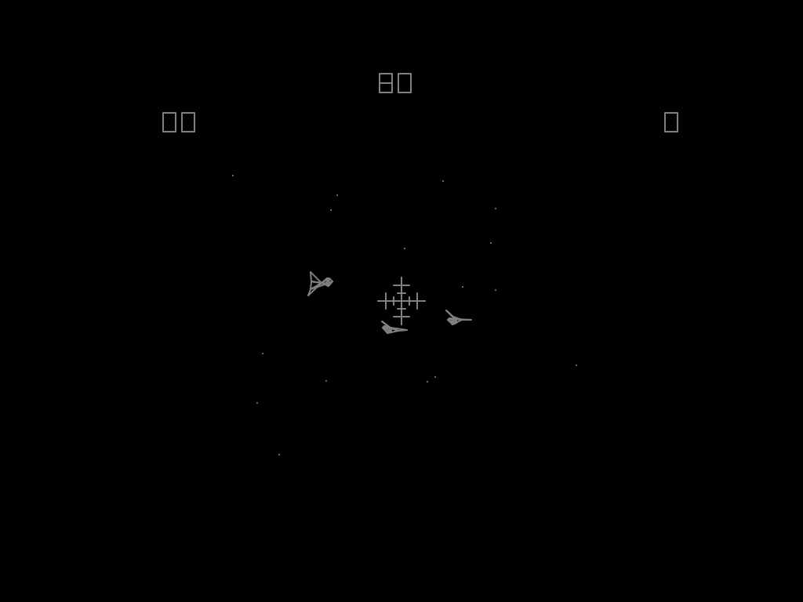
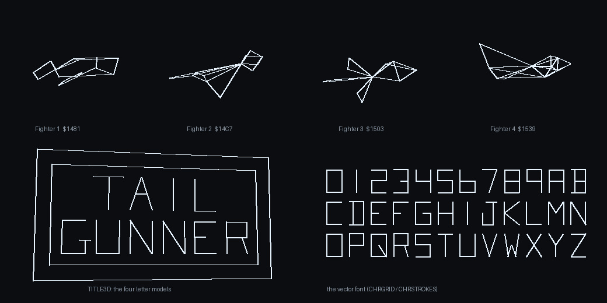

# Tailgunner — full disassembly

An annotated, byte-exact **disassembly of Tailgunner** (Cinematronics, 1979), the vector
game where you hold off waves of 3D fighters from the tail gun of a starship, and a
small **test emulator** that plays the original ROM beside it. The format follows the
[Tempest disassembly](https://github.com/tcottrill/Tempest-Full-Disassembly-and-C-Port);
a C port is planned as the next stage.

Tailgunner runs on the **Cinematronics CCPU**, a processor built from TTL chips: 12-bit
accumulators, 8-bit opcodes, 8K of program ROM in two banks and 256 words of RAM. No
source code is known to survive, so unlike Tempest there was nothing to re-assemble.
The listing was recovered by **running the ROM**: the CCPU core of the
[AAE emulator](https://github.com/tcottrill/AAE) executes the program inside a tracing
harness that records what every byte does, a static walk follows the jumps from there,
and every name, comment and table decoding was then written by reading the code and
checking it against RAM snapshots and captured frames.

<p align="center">
  
  &nbsp;
  <a href="disasm/shapes_preview.html">
    
  </a>
  <br>
  <sub>Left: the test emulator, <code>emu_src/tailgunner_emu.exe</code>. Right: part of
  <a href="disasm/shapes_preview.html"><code>disasm/shapes_preview.html</code></a>, which draws
  every model, letter, character and shape the ROM keeps in a table, the 3D ones turning.</sub>
</p>

## What's in the repository

| where | what |
|-------|------|
| [`disasm/`](disasm/README.md) | the listing `tailgunner_program_rom.asm`, which re-encodes to the ROM byte for byte; `tailgunner_defines.asm` with the I/O bits, the sound register and all 256 RAM words; `shapes_preview.html`; and the Python tools and C++ tracing harness that generate and verify all of it from a ROM set |
| [`emu_src/`](emu_src/README.md) | `tailgunner_emu.exe`, a test emulator that plays the real ROM on the same CCPU core, with vector rendering, sound, mouse / keyboard / joystick and an ini file; prebuilt, or built with `build_emu.bat` and Visual Studio 2022 |
| `samples/` | `tailg.zip`, the six WAV samples the emulator plays: the sound board itself is not emulated, its sounds are played as recordings when the program switches them on |
| `docs/` | the images above |

## No ROMs included — bring your own

The ROM images are not distributed. The listing and the defines are checked in, so
nothing needs a ROM to be read, but the tools that regenerate them and the emulator do.
Both take a MAME `tailg` set — `tailg.zip` or the four chips `tgunner.t70`, `.p70`, `.t71`,
`.p71` loose — found by CRC32 in `roms\` at the top of the tree (or a path you give).

## Quick start

Play the original:

```bat
cd emu_src
tailgunner_emu.exe
```

Mouse or arrow keys aim, Ctrl / left button fires, Alt / right button raises the shield,
5 adds a coin and 1 starts; [`emu_src/README.md`](emu_src/README.md) has the rest.

Regenerate and verify every listing from your ROMs (Python 3; the first run builds the
tracing harness, which needs Visual Studio 2022):

```bat
cd disasm
python gen_from_roms.py ..\roms\tailg.zip --traces
```

It must end with `MISMATCHES : 0` and `PAGE ERRORS : 0`.

## The listing

| | |
|---|---|
| program ROM bytes re-encoded from the listing and compared | **8,192 / 8,192, 0 mismatches** |
| RAM page checks (every full RAM address against the last `SETP` on its path) | **0 errors** |
| instructions | **5,276**: 5,032 executed in the traces, 244 found by following jumps |
| routine headers, all described | **63** |
| RAM words named and described | **256 of 256** (about 45 are never used) |
| data tables decoded record by record | models, letters, test figure, crosshair, shield, font, strings, formations, sine tables |

Every conditional jump carries its real condition (`;if FTRS_LEFT = 0 -> L00DF`), every
indirect RAM access the word it touches, every call its parameters, every sound command
the sound it starts or stops — worked out by a small simulation of the CCPU's registers
and flags along each straight-line run — and the hand-written notes say what the code is
for. [`disasm/README.md`](disasm/README.md) describes the instruction set, the syntax and
the conventions.

## What the disassembly found

- **You look backward.** The stars run *in* toward the centre (each moves 1/32 of its
  distance a frame), as two captured frames confirm, because the gun points out of the
  tail.
- **The game ends on fighters that get past, not on shields.** Ten may slip by; a counter
  at the top right shows how many have. The shields (a flickering lattice of diamonds
  across the screen) only buy time, 1 point every 8 frames.
- **Hyperspace is a penalty.** Shoot all three fighters and the next wave starts at once;
  let one past and the ship jumps to hyperspace first, the stars rushing in.
- **Two lasers close on the crosshair** from the bottom corners over 9 frames; only the
  last three can hit, and the target grows as a fighter comes nearer. The third hit of
  a wave scores double.
- **Waves get faster with the score**, and each wave's fighter model, points (7, 11, 17
  or 23) and formation come from a pseudo-random number. The score shows four digits; past
  9999 a hex digit appears ("E442").
- **A real 3D engine.** Fighters are wireframe models rotated three times with a
  three-multiply trick, projected with a shift-and-subtract divide, and banked as they
  turn; an explosion is the same model drawn with its edges flung out from the centre.
  The star field's random numbers are bytes read from all over the program itself.
- **A test pattern** appears when the game is powered on with START held.
- **The EPROMs carry leftovers**: 935 bytes are 8080 machine code and the text
  `NEXT  PC` from the development system.

## Sources, and what is not included

- The CCPU core `emu_src/cpu/ccpu.cpp` is Aaron Giles' (MAME), written with Zonn Moore's
  documentation of the Cinematronics CPU, as adapted in the AAE emulator. Hardware facts
  (inputs, DIP wiring, coin latch, the stick comparator, the sound latch) come from AAE's
  Cinematronics driver, itself after MAME's `cinemat.cpp`.
- The emulator's Windows platform layer comes from the Tempest project; its third-party
  files (GLEW, miniz) keep their own headers and terms.
- ROM images are not included. The samples are included for the emulator.

## License

The disassembly, the tools and the emulator are released under the **GNU General Public
License, version 3 or later** (see [`LICENSE`](LICENSE)), the terms of the AAE CCPU and
video files the emulator is built from. Files from other projects keep their own headers
and terms. Tailgunner is a trademark of its owner, and no ROM images are included.
